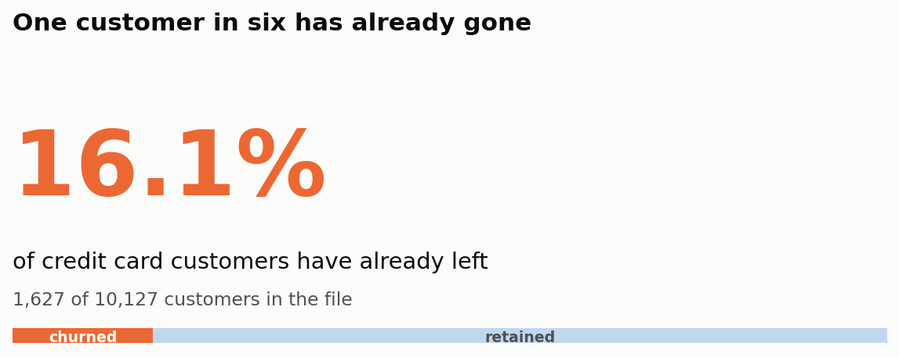
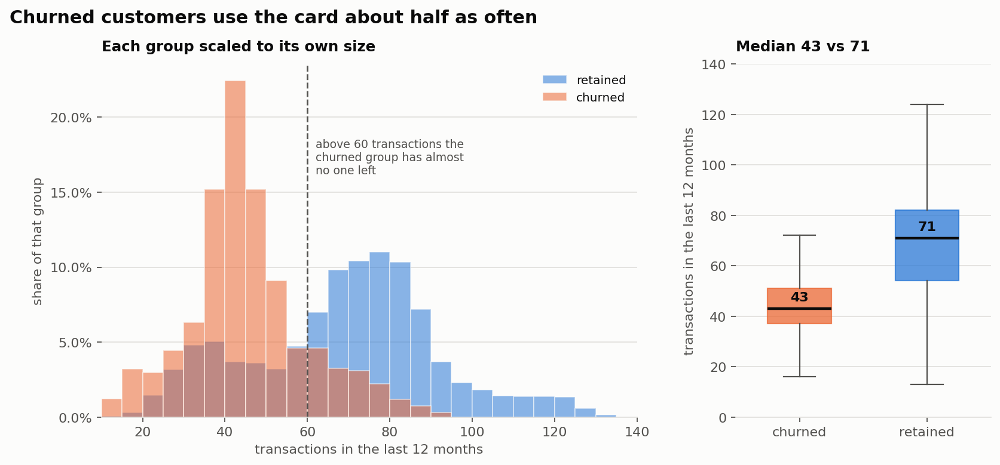
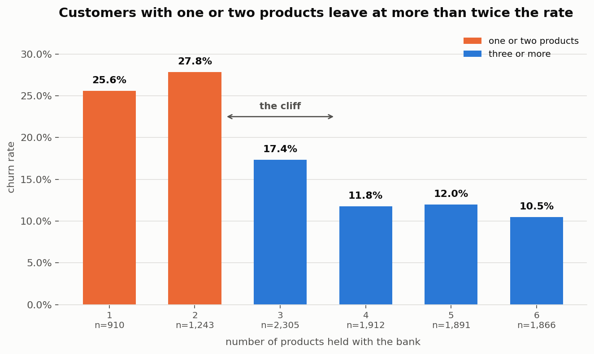
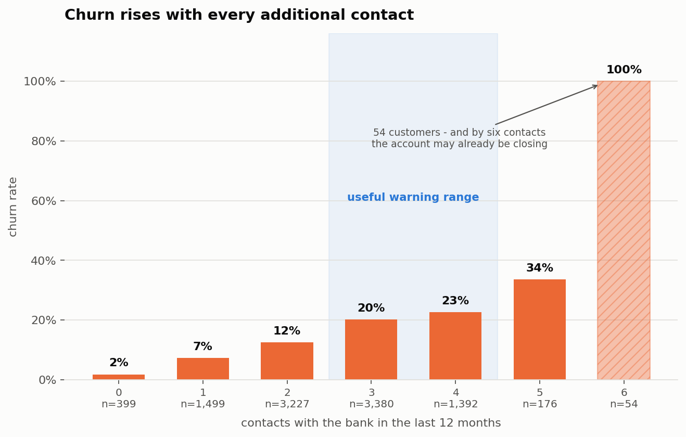
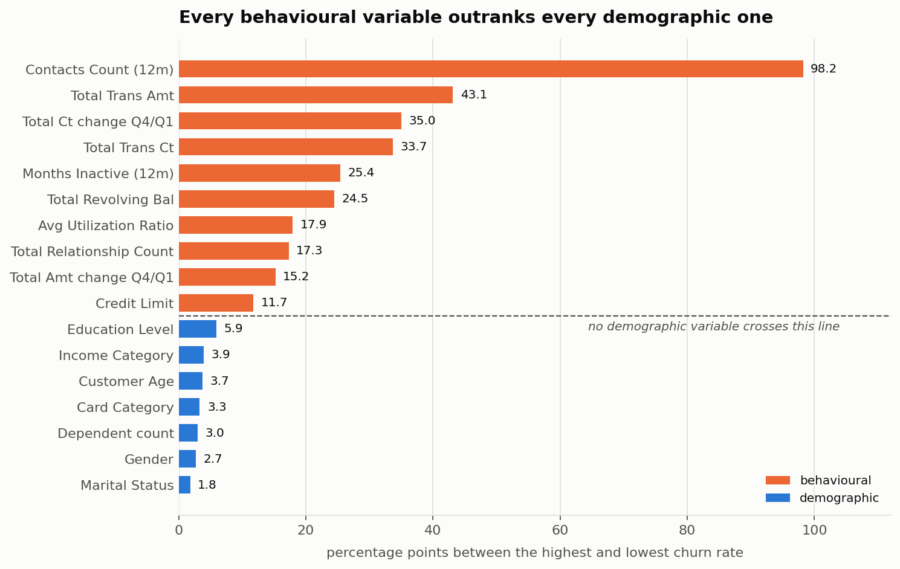
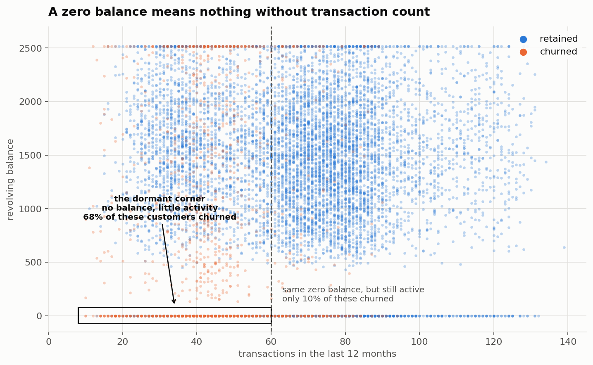

# Credit Card Customer Churn Analysis

An exploratory data analysis of credit card customer attrition, carried out as
the Unit 1 Data Analytics capstone project.

The project takes a bank's credit card customer file and works out **who leaves,
what those customers look like before they go, and which signals appear early
enough to be useful**. The work is deliberately limited to data understanding,
cleaning, exploration and visualisation. No predictive model is built - the
question here is what the data says, not what a classifier can score.

**Headline result:** 16.07% of customers have churned, and every behavioural
variable in the file separates leavers from stayers more sharply than every
demographic one - without a single exception.

---

## Business Context

Credit card attrition is expensive. Acquiring a replacement customer costs
considerably more than keeping an existing one, and a customer who closes an
account rarely returns. The bank's retention team cannot contact everybody, so it
needs to know which customers to approach and when.

The team currently has no evidence base for that decision. They have a customer
file with demographic and transactional attributes and a flag showing who has
already left, but nobody has examined it.

## Business Requirements

**BR1 - Understand the scale and shape of the problem.**
Establish what proportion of customers have churned, and whether the two groups
are balanced enough for straightforward comparison.

**BR2 - Identify which customer attributes distinguish churned from retained
customers.**
Examine demographic and behavioural attributes and establish which of them
actually separate the two groups rather than merely varying across the file.

**BR3 - Present the findings visually for a non-technical audience.**
A small set of clear plots that support a decision, each with the takeaway stated
in plain language.

All three are answered below.

---

## Dataset Content

The dataset is *Credit Card customers*, published on Kaggle by Sakshi Goyal and
sourced originally from the Analyttica LEAPS platform. It holds **10,127
customers and 23 columns**, with no repeated customer IDs - one row is one
customer.

The raw file is kept unmodified at `inputs/datasets/raw/BankChurners.csv`.
Cleaning writes to `outputs/datasets/cleaned/`, so every step can be re-run from
the original source.

### Columns used in the analysis

| Column | Meaning |
|---|---|
| `Attrition_Flag` | Target. Existing or attrited customer |
| `Churn` | Added during cleaning. 1 = attrited, 0 = existing |
| `Customer_Age` | Age in years (26-73) |
| `Gender` | M / F |
| `Dependent_count` | Number of dependants (0-5) |
| `Education_Level` | Uneducated through Doctorate |
| `Marital_Status` | Married / Single / Divorced |
| `Income_Category` | Five bands, under $40K to $120K+ |
| `Card_Category` | Blue / Silver / Gold / Platinum |
| `Months_on_book` | Tenure with the bank - **unreliable, see limitations** |
| `Total_Relationship_Count` | Products held with the bank (1-6) |
| `Months_Inactive_12_mon` | Months with no activity in the last year |
| `Contacts_Count_12_mon` | Contacts with the bank in the last year |
| `Credit_Limit` | Credit limit on the card |
| `Total_Revolving_Bal` | Revolving balance carried |
| `Total_Amt_Chng_Q4_Q1` | Change in transaction *amount*, Q4 vs Q1 |
| `Total_Trans_Amt` | Total transaction amount, last 12 months |
| `Total_Trans_Ct` | Total transaction count, last 12 months |
| `Total_Ct_Chng_Q4_Q1` | Change in transaction *count*, Q4 vs Q1 |
| `Avg_Utilization_Ratio` | Revolving balance as a share of credit limit |

### Columns removed, and why

Four columns were dropped during cleaning. Each reason was verified in the data
rather than taken on trust.

| Column | Reason |
|---|---|
| `CLIENTNUM` | Unique in all 10,127 rows. An identifier, not an attribute. |
| `Avg_Open_To_Buy` | Exactly `Credit_Limit` - `Total_Revolving_Bal`, in every row. |
| `Naive_Bayes_Classifier_..._1` | **Target leakage** - see below |
| `Naive_Bayes_Classifier_..._2` | **Target leakage** - see below |

The two Naive Bayes columns are the stored output of a classifier that was fitted
on the target and left in the file. Thresholding the first at 0.5 reproduces
`Attrition_Flag` for **every single row - 100% agreement**. Any analysis
including them would find them overwhelmingly the strongest signal, and that
result would be entirely circular.

### The missing data is disguised

`df.isna()` reports a completely clean file. It is not one. Three columns use
`"Unknown"` in place of a real value:

| Column | Unknown | Share |
|---|---|---|
| `Education_Level` | 1,519 | 15.0% |
| `Income_Category` | 1,112 | 11.0% |
| `Marital_Status` | 749 | 7.4% |

**30.1% of customers have at least one.** Three responses were possible: drop
those rows (losing nearly a third of the file), impute them (inventing
demographics), or treat them as genuinely missing. The third is only safe if the
missingness is unrelated to churn, so that was tested rather than assumed:

| Column | Churn if Unknown | Churn if known | chi-square p |
|---|---|---|---|
| `Education_Level` | 16.85% | 15.93% | 0.385 |
| `Income_Category` | 16.82% | 15.97% | 0.497 |
| `Marital_Status` | 17.22% | 15.97% | 0.399 |

No association at all. `"Unknown"` was therefore converted to a real missing
value and **nothing was imputed anywhere in this project**. Demographic
comparisons run on the customers whose attribute is actually recorded, and each
chart states its own denominator.

---

## Hypotheses and How They Were Validated

Each hypothesis was stated in business terms, mapped to specific columns, and
tested with a significance test reported alongside an effect size. With 10,127
rows almost anything reaches significance, so the conclusions lean on the effect
sizes.

| | Hypothesis | Verdict |
|---|---|---|
| **H1** | Disengagement precedes departure | **Supported** |
| **H2** | A thinner relationship is easier to leave | **Supported** |
| **H3** | A falling spend trend is a warning sign | **Partly supported** |
| **H4** | Repeated contact signals an unresolved problem | **Supported** |
| **H5** | Behaviour beats demography | **Supported without exception** |

**H1** - Transaction count is the strongest single discriminator in the file: a
median of **43 transactions for churned customers against 71 for retained**
(Mann-Whitney p < 0.001, rank-biserial 0.59). Inactivity tracks churn across the
1-4 month range that covers nearly all customers; the tails are unstable and are
not used.

**H2** - Churn runs at **25.6% and 27.8%** for customers holding one or two
products, against **10-12%** for those holding four or more.

**H3** - Supported for transaction *count* (median ratio 0.53 vs 0.72,
rank-biserial 0.49), but only weakly for *amount* (0.70 vs 0.74, rank-biserial
0.16). The distinction matters and is discussed in the findings.

**H4** - Churn rises monotonically with every additional contact, from 1.8% at
zero to 33.5% at five.

**H5** - Every behavioural variable outranks every demographic one on both
measures used. Full detail below.

---

## Findings

Six figures, each answering one question. The plot type was chosen per figure
from what the data had to say rather than applied uniformly:

| Figure | Plot type | Why that form |
|---|---|---|
| 1 | Hero number + proportion bar | A single proportion is a number, not a chart |
| 2 | Histogram + box plot | Comparing two distributions, not a rate |
| 3 | Bar chart | Churn rate across a discrete count |
| 4 | Bar chart | Churn rate across a discrete count |
| 5 | Horizontal bar chart | A ranking of 17 variables |
| 6 | Scatter plot | The finding only holds for two variables together |

### 1. One customer in six has already gone (BR1)



**1,627 of 10,127 customers - 16.07%.** The classes are imbalanced roughly 5:1,
which is why every comparison in this project is reported as a **rate within each
group** rather than as a count. A count chart here would show that most churners
hold Blue cards, but so does almost everybody, and it would say nothing.

### 2. Churned customers use the card about half as often



The median churned customer makes **43 transactions a year against 71** for the
median retained customer. The histogram scales each group to its own size so the
shapes can be compared despite the 5:1 imbalance: the churned group is
concentrated between roughly 30 and 55 transactions with almost nobody above 60,
while the retained group centres on 70-80 with a long tail upward. The box plot
summarises the same variable - the two boxes barely overlap.

**Churn rate by activity band is deliberately reported as a table rather than a
chart**, because that relationship is not a clean slope. Above 60 transactions
churn drops to 8%, then 4%, then 1%. Below 60 it runs between 22% and 48% but is
*not* ordered - it peaks at 48% in the 41-50 band and is lower at both ends,
since churned customers cluster around a median of 43 and the lowest band holds
only 698 people.

So the threshold is the finding; the ranking of the bands below it is not. A bar
chart of those rates would have implied a gradient that does not exist, which is
why the figure shows the distributions instead.

### 3. The cliff sits between two products and three



Churn is 25.6% at one product and 27.8% at two, then drops to 17.4% at three and
settles at 10-12% from four upwards. This is a cliff, not a gradient - which
makes it directly actionable. The goal for a one- or two-product customer is a
third product; pushing a four-product customer to five buys very little.

### 4. Every additional contact raises the risk



Churn climbs at every step: 1.8% at zero contacts, 12.5% at two, 22.6% at four,
33.5% at five - and 100% at six.

**That last figure needs care rather than excitement.** All 54 customers who made
six contacts churned, every one. A rate of exactly 100% on a clean threshold is
almost always structural rather than behavioural: six contacts is plausibly where
an account closure process begins, in which case the contacts are part of leaving
rather than a warning that precedes it. The direction of causation is genuinely
unknown, and it changes what the finding is worth - if repeated contact
frustrates customers into leaving, better first-contact resolution reduces churn;
if contacts are simply what leaving looks like administratively, acting at six is
far too late. Contact count is treated as a **useful flag at three to five**,
where the gradient is steep but the outcome is not yet settled.

### 5. Behaviour beats demography, without exception (BR2)



This is the commercially important result. Each variable is scored by **spread** -
how many percentage points separate its highest and lowest churn rate, with
continuous variables cut into quintiles and any group under 30 customers
excluded - and cross-checked with Cramer's V.

| | Spread | Cramer's V |
|---|---|---|
| Behavioural (10 variables) | 11.7 - 98.2 pp | 0.105 - 0.427 |
| Demographic (7 variables) | 1.8 - 5.9 pp | 0.015 - 0.038 |

There is **no overlap between the two groups at all**. The weakest behavioural
variable, `Credit_Limit`, moves the churn rate twice as far as the strongest
demographic one. The entire spread across education levels is 5.9 percentage
points and across marital status 1.8. On `Customer_Age` the Mann-Whitney test
does not even reach significance (p = 0.078) despite 10,127 rows - the median
churned customer is 47 and the median retained customer is 46.

### 6. Customers stop *using* the card before they stop *spending* on it

This one does not have its own figure, but it is the finding most likely to be
missed in routine reporting.

The quarter-on-quarter change in transaction **count** separates the groups
clearly - a median ratio of **0.53 for churned customers against 0.72 for
retained**. The change in **amount** barely separates them at all: **0.70 against
0.74**. Both are statistically significant; only the first is large enough to act
on.

The two sound interchangeable and are not. Frequency falls away first while the
amount per remaining transaction holds up, which means **a report tracking spend
alone would show almost nothing** while a report tracking transaction count would
show the customer leaving.

### 7. A zero balance means nothing on its own



The finding none of the hypotheses anticipated: **54.9% of churned customers
carry a zero revolving balance, against 18.6% of retained** - three times the
rate.

It cannot be used by itself, because zero has two opposite meanings. A customer
who pays their balance in full every month has a zero balance and is a good
customer. A customer who has quietly stopped using the card also has a zero
balance. In this file they are indistinguishable in that column alone.

Transaction count separates them, which is why this one is drawn as a scatter -
the finding lives in two variables at once and no single-variable chart can show
it. The dense band along the bottom of the figure is every zero-balance customer;
split it at 60 transactions and it comes apart. Those in the boxed corner - no
balance and little activity - churn at **68.0%** (n = 1,108), while zero-balance
customers still transacting freely churn at **10.3%** (n = 1,362). A campaign
aimed at the whole bottom band would spend most of its budget on people who are
simply paying their bills.

---

## Conclusions and Recommendations

**Answering BR2 directly:** the attributes that distinguish churned from retained
customers are, in order of strength - transaction count, transaction amount, the
quarter-on-quarter change in transaction count, contact frequency, revolving
balance and product holdings. Demographic attributes do not meaningfully separate
the two groups.

**For the retention team:**

1. **Build triggers from account activity, not customer profiles.** Transaction
   count is the strongest signal available and it is observable monthly.
2. **Use a compound trigger, not a single threshold.** Zero revolving balance
   *plus* falling transaction count identifies dormancy; either alone does not.
3. **Watch transaction count, not spend.** Frequency drops first; a spend-based
   report will miss the customer leaving.
4. **Treat three to five contacts in a year as a live warning.** By six the
   account is likely already closing.
5. **Target one- and two-product customers, aiming for a third product.** That is
   where the cliff is; effort spent moving four-product customers to five is
   largely wasted.

**On demographic targeting:** it would carry discrimination risk for very little
return. Gender and age are protected characteristics under the Equality Act 2010.
Income, education and marital status are not, but they are sensitive demographic
attributes that can act as proxies for protected ones. All of them barely move
the churn rate. The ethical constraint and the commercial
evidence point the same way here - though it is worth noting that this did not
have to be the case. Had education been strongly predictive, the recommendation
would still have been to avoid targeting on it, and the analysis would have been
less comfortable.

---

## Limitations

Stated plainly, because each one bounds what the findings above can carry.

* **`Months_on_book` is unreliable and unused.** 24.3% of customers sit at
  exactly 36 months while neighbouring values hold around 350 each. A genuine
  tenure distribution does not do that; it looks like a default written in where
  the real value was missing. It also correlates 0.79 with `Customer_Age`. No
  conclusion here rests on it.
* **Everything here is association, not cause.** This is observational data with
  no experiment behind it. Contact count is the clearest case - it may drive
  customers away, or merely record customers already leaving.
* **The retained group contains future leavers.** Customers marked as retained
  are only retained *so far*. That blunts every contrast in this report, which
  makes the differences reported here conservative rather than overstated.
* **Three results rest on thin samples** and are flagged wherever they appear:
  100% churn at six contacts (54 customers), 51.7% at zero months inactive (29
  customers), and 25% churn among Platinum cardholders (20 customers). The last
  is excluded from the ranking by a 30-customer floor.
* **No time dimension.** The file is a snapshot, so nothing here establishes how
  far in advance a signal appears - only that it is present at the point of
  observation.
* **`ppscore` was tried and abandoned.** It returns 0.00 for all 18 variables,
  including transaction count. That is the measure failing on an 84/16 target -
  its naive baseline is already strong enough that no single variable beats it -
  not the data saying nothing. It is recorded rather than quietly dropped,
  because a table of eighteen zeros is easy to mistake for evidence.

---

## Ethical and Privacy Considerations

**Protected characteristics are analysed, not acted upon.**
The file includes gender, income band, education, marital status and dependants.
These were examined to answer BR2 honestly - it would be poor analysis to claim
demography does not matter without checking. But an association found in this
data is not a licence to target on it. Gender and age are protected
characteristics under the Equality Act 2010; income, education and marital status
are not protected in themselves, but they correlate with characteristics that
are, so they can act as proxies. Using any of them to decide who receives a
retention offer risks discriminatory or unequal treatment, regardless of what the
correlation says. As it turns out the
demographic signals are weak, so the recommended triggers are behavioural on both
ethical and practical grounds.

**Correlation is not cause.**
Findings are written as associations throughout, and the direction of causation
is flagged as unknown wherever it cannot be established.

**Nothing was imputed.**
Filling 1,519 customers' education with the modal value would have produced
charts that look more complete and are less true. Missing values are reported as
missing and excluded from the comparisons they cannot inform.

**Survivorship in the comparison group.**
Customers marked as retained are only retained so far, as noted in limitations.

**Identifiability.**
The data carries no names, addresses or account numbers - only a surrogate
customer ID, dropped before analysis. The remaining attributes are coarse enough
that re-identification from this file alone is not a realistic concern.

---

## Project Structure

```
├── inputs/datasets/raw/          BankChurners.csv, never modified
├── jupyter_notebooks/            the four analysis notebooks
├── outputs/
│   ├── datasets/cleaned/         cleaned dataset written by notebook 02
│   ├── figures/                  the six figures from notebook 04
│   └── reports/                  variable ranking; profiling HTML (gitignored)
├── requirements.txt
└── README.md
```

## The Notebooks

Run them in order - each depends on the output of the one before.

| Notebook | What it does |
|---|---|
| `01_data_understanding.ipynb` | Inspects the raw file. Answers BR1, finds the disguised missing values, the derived columns and the target leakage. |
| `02_data_cleaning.ipynb` | Drops the four unusable columns, encodes the target, tests whether the missingness is random, orders the ordinal categories. |
| `03_exploratory_data_analysis.ipynb` | Tests all five hypotheses. Answers BR2 and produces the variable ranking. |
| `04_data_visualisation.ipynb` | Produces the six figures. Answers BR3. |

## Technologies Used

- **Python 3.12.8**
- **pandas**, **numpy** - data handling
- **scipy** - chi-square and Mann-Whitney tests
- **matplotlib** - visualisation
- **ydata-profiling** - automated first-pass profiling
- **ppscore** - predictive power score (tried, unsuitable here - see limitations)
- **Jupyter Notebook** - analysis environment

Chart colours are the first two slots of a categorical palette checked for
colour-blind separation and for contrast against the chart background before use,
rather than chosen by eye. No figure encodes anything by colour alone, and the
six figures between them use bar, horizontal bar, histogram, box plot and scatter
forms.

## Setting Up Locally

```bash
python -m venv .venv
source .venv/Scripts/activate     # Windows: .venv\Scripts\activate
pip install --upgrade pip
```

Two install quirks are worth knowing about, both of which break a clean install:

* `ppscore` 1.1.0 imports `pkg_resources` at build time, which setuptools 81
  removed. Install an older setuptools first and build without isolation.
* IPython 9 removed `backend2gui`, which matplotlib 3.8.0 imports as soon as
  pyplot sets up its display hook - so any notebook that draws a chart dies with
  an `ImportError`. `requirements.txt` pins `ipython<9`.

```bash
pip install "setuptools<81" wheel
pip install -r requirements.txt --no-build-isolation
```

Then launch the notebooks:

```bash
jupyter notebook
```

## Credits

Dataset published on Kaggle as *Credit Card customers* by Sakshi Goyal,
originally sourced from the Analyttica LEAPS platform.

Project structure based on the Code Institute Data Analytics capstone template.
